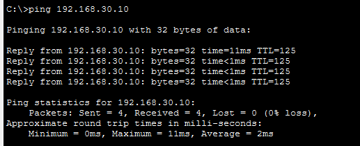

# OSPF Routing and Troubleshooting Lab

## Project Overview

This project demonstrates the implementation and analysis of the Open Shortest Path First (OSPF) routing protocol using Cisco Packet Tracer.

A simulated enterprise network was designed using three Cisco routers, three switches, and three PCs. OSPF Area 0 was configured to enable dynamic routing between the networks.

The project also includes network connectivity verification, OSPF neighbor analysis, link-failure troubleshooting, and OSPF packet inspection using Cisco Packet Tracer Simulation Mode.

## Objectives

- Design a multi-router enterprise network.
- Configure IPv4 addressing on router interfaces and PCs.
- Establish OSPF neighbor relationships.
- Verify dynamically learned OSPF routes.
- Test end-to-end connectivity between different LANs.
- Observe network behavior during link failure and recovery.
- Analyze OSPF protocol packets.

## Tools and Technologies

- Cisco Packet Tracer
- Cisco IOS CLI
- OSPFv2
- IPv4 Addressing and Subnetting
- ICMP
- Cisco Packet Tracer Simulation Mode

## Network Topology

The simulated network consists of:

- 3 Cisco routers
- 3 Cisco switches
- 3 PCs
- OSPF Area 0

## IP Addressing Scheme

| Network | Subnet |

| LAN 1 | 192.168.10.0/24 |
| LAN 2 | 192.168.20.0/24 |
| LAN 3 | 192.168.30.0/24 |
| R1–R2 | 10.0.12.0/30 |
| R2–R3 | 10.0.23.0/30 |

## OSPF Configuration

OSPF process 1 was configured on all three routers using backbone Area 0.

Router IDs:

- R1: 1.1.1.1
- R2: 2.2.2.2
- R3: 3.3.3.3

## Verification and Results

### 1. OSPF Neighbor Formation

The `show ip ospf neighbor` command confirmed that R1 established an OSPF adjacency with R2.

Observed neighbor state: `FULL/BDR`

### 2. Dynamic Route Learning

The `show ip route ospf` command confirmed that R1 learned remote routes, including:

- 10.0.23.0/30
- 192.168.20.0/24
- 192.168.30.0/24

### 3. End-to-End Connectivity

Connectivity was tested between PC1 and PC3 using ICMP ping.

The initial test received 3 successful replies out of 4 requests. The first request timed out, while subsequent requests succeeded.

### 4. Link Failure and Recovery

A simulated link failure was introduced between R2 and R3.

The experiment demonstrated changes in OSPF routing information during the failure and recovery of connectivity after the link was restored.

### 5. OSPF Packet Analysis

The following packet types were captured and inspected using Packet Tracer Simulation Mode:

| Packet Type | Description |

| Type 1 | Hello |

| Type 2 | Database Description |

| Type 4 | Link-State Update |

Router LSA (Type 1) and Network LSA (Type 2) headers were also examined.

## Key Learnings

- How OSPF routers discover neighbors and establish adjacencies.
- How dynamic routes are advertised and learned.
- How OSPF metrics influence routing.
- How routing information changes during network failures.
- How to inspect OSPF packets and LSAs.
- How to troubleshoot network connectivity using Cisco IOS commands.

## Future Improvements

- Implement multi-area OSPF.
- Configure OSPF authentication.
- Investigate redundant paths and convergence.
- Compare OSPF and BGP routing behavior.
- Develop a separate BGP routing and security lab.

## Project Files

The Cisco Packet Tracer `.pkt` file is included in this repository so the topology and configurations can be reviewed and reproduced.

## Author

G.Shiva Sai Mounica | Hands-on Network Security Projects
